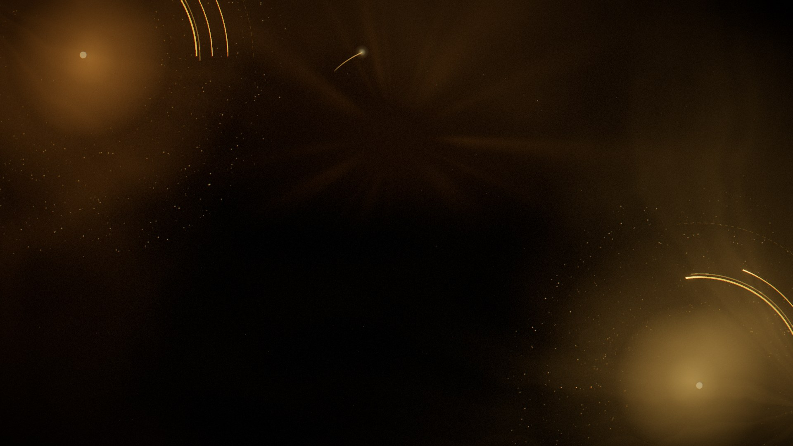
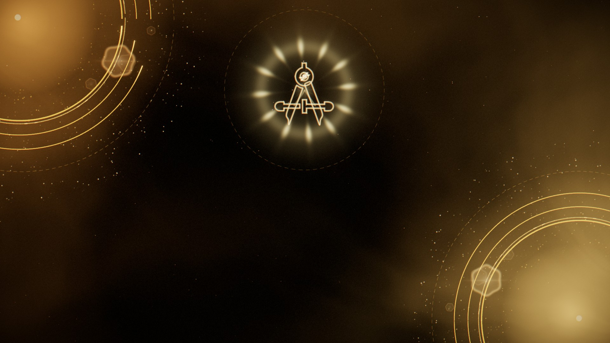
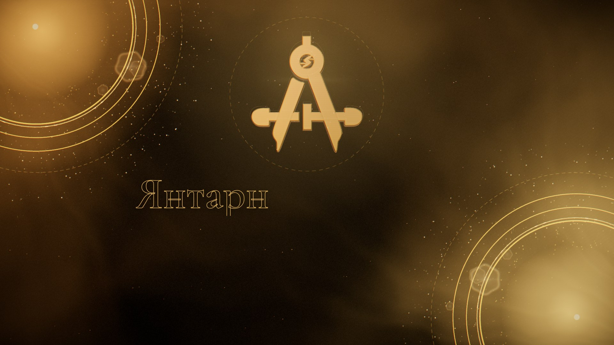

# Янтарный циркуль — режиссёрский аниматик вступительного ролика №1

**Формат:** 1920×1080, петля 15,3 с, 60 FPS. Время ниже — секунды с запуска страницы при значениях `DEFAULTS`. Музыкальные отметки — **предложения**, звук в код не встроен: его нужно согласовать с программой вечера, чтобы повторение не утомляло гостей.

| Время | Ключевой кадр / действие | Звук, если нужен |
| --- | --- | --- |
| 0,00–0,60 | Тёмный кадр. Пространство для шва, без логотипа и надписи. | Тишина. |
| 0,60–1,25 | От верхнего левого света появляется точка циркуля. Она начинает очерчивать центральную окружность **раньше** символа; крайние кольца чертятся медленными дугами, за ними постепенно открываются риски и разметка. | Очень тихий сухой «щелчок» чертёжного инструмента. |
| 1,25–2,16 | Точка замыкает окружность, оставляя тонкий золотой построительный след. | Начинается один мягкий восходящий тон. |
| 2,16–3,50 | Тот же световой наконечник переходит к первой точке SVG-контура и запускает его прорисовку; построительная окружность гаснет. | Тон достигает пика в момент передачи и затухает. |
| 3,50–5,60 | Контур приобретает объём: **первый ролик открывается ударом света от циркуля** — тёплая кольцевая волна расширяется за знаком и растворяется, камера наезжает на металл и возвращается к композиции. Радиальный фронт открывает грани. Название последовательно гравируется **по буквам контуром**, затем каждая буква получает заливку. У крайних колец — короткие солнечные блики и мягкие кружки боке. [Кадр импульса](intro-impact.jpg). | Короткое металлическое раскрытие на переходе в золото. |
| 5,60–7,10 | Один короткий тёплый блик проходит по символу; разделители, подзаголовок и дата тоже сначала пишутся по буквам контуром, потом заполняются. Угловой свет уступает центру; к ~6,7 с весь титр читаем. | Звук затухает до начала удержания. |
| 7,10–12,40 | Полная композиция: читаемые символ, название, подзаголовок, дата. Световой фронт уже исчез, остаётся едва заметное дыхание логотипа и среды. | Без повторяющегося акцента: это удержание вступительного титра. |
| 12,40–13,78 | Дата → подзаголовок → название уходят последовательно. Золото остаётся на мгновение дольше слов. | Тихое обратное затухание, без нового «удара». |
| 13,78–14,70 | Золотая поверхность уходит; детали контура растворяются, свет отматывает линию оголовка к первой точке чертежа. | Мягкая конечная точка. |
| 14,70–15,90 | Тёмная пауза, последний и первый кадры петли совпадают. | Тишина. |

## Семь визуальных опорных кадров

**1 · Точка и первый штрих, 1,10 с**

**2 · Передача света, 2,86 с**

**3 · Прорисовка символа, 3,39 с**

**4 · Переход к золоту и названию, 4,76 с**

**5 · Световой проход, 6,14 с**

**6 · Собранная композиция, 9,34 с**

**7 · Последняя дуга оголовка, 14,52 с**

## Два контрольных style frame

1. **Превращение (~4,2 с):** тёмный металл и тёплая светящаяся кромка; детали циркуля должны читаться, белых пятен нет. Пунктирная окружность — инструмент построения, а не второй логотип.
2. **Собранная композиция (~8,8 с):** на лицевой поверхности — мягкий переход от светлого золота слева сверху к глубокому янтарю справа внизу; боковые грани сохраняют отражения, фактура остаётся тонкой. Название первично, угловые огни поддерживают глубину, дата читаема на реальном экране с дистанции зала.

Проверять не только два кадра, но и переходы между ними: в браузере `?review=1` или клавиша **R** открывают шкалу времени с этими семью точками, паузой и шагом по кадрам. Семь ключевых кадров в `docs/storyboard/` — обзорные JPEG, не финальный мастер. Чтобы переснять их после изменения сцен: `npm run dev`, затем `OUT=docs/storyboard npm run render:storyboard`. Скрипт берёт время фаз из текущего конфига и обновляет `timing.json`; без `OUT` кладёт результаты в `out/storyboard/` (не в Git). Для итогового ролика — `npm run render:frames`.

## Границы арт-дирекшена

- Одна причинно-следственная линия: **свет → инструмент → символ → название**, а не независимые спецэффекты.
- Блик проходит по символу только при сборке надписи и затухает до её полного удержания. Угловой свет и движение фона становятся тише, когда текст готов.
- Фактура золота только на металле; тонкая и отфильтрованная на мелких размерах, без муара.
- Петля должна оставаться без заметного стыка и без звукового события в конце/начале.
- Для следующих заставок можно переиспользовать чертёжный жест, меняя текст, паузы и финальный кадр; сценарии следующих сцен согласовываются отдельно.
