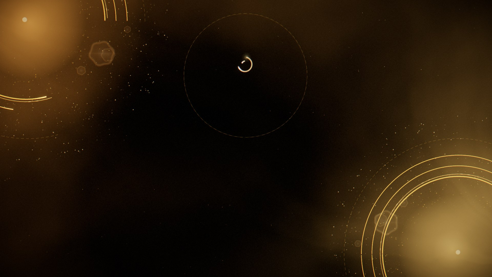
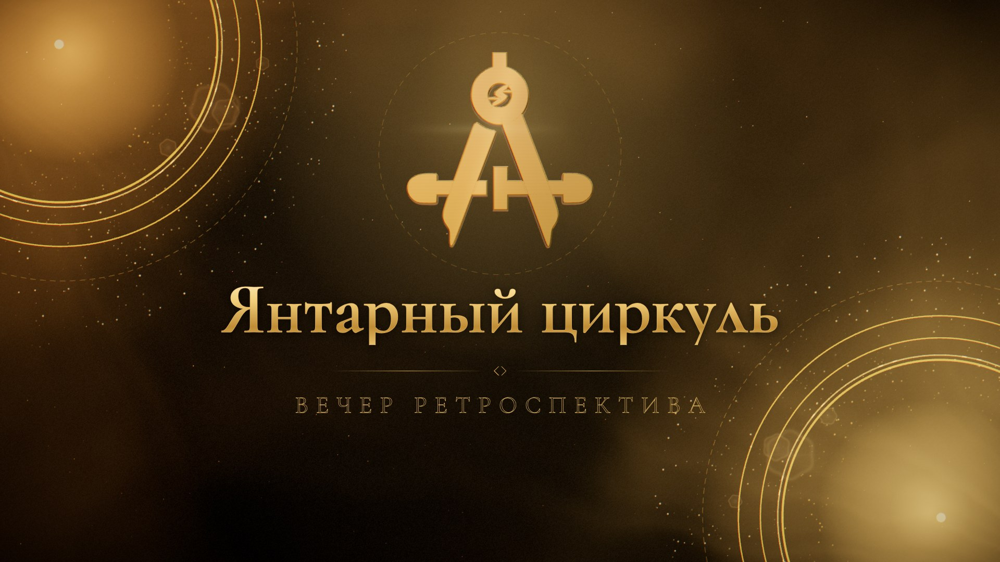
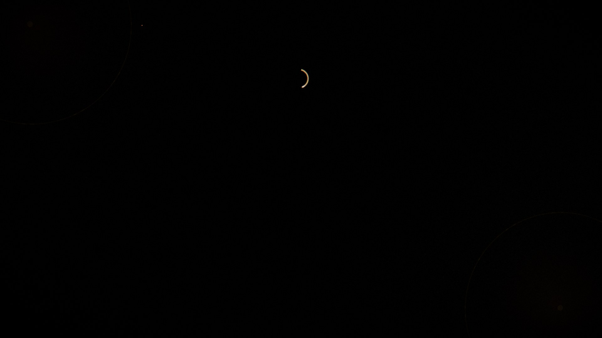

# Янтарный циркуль — режиссёрский аниматик вступительного ролика №1

**Формат:** 1920×1080, петля 15,3 с, 60 FPS. Время ниже — секунды с запуска страницы при значениях `DEFAULTS`. Музыкальные отметки — **предложения**, звук в код не встроен: его нужно согласовать с программой вечера, чтобы повторение не утомляло гостей.

> Актуальный пресет по умолчанию — `circle-first`: сначала построительная окружность и логотип появляются в центре, затем логотип плавно поднимается на рабочую ось, и только после этого под ним начинает писаться титр. Прежняя раскадровка «три такта» остаётся выбираемой в настройках `Интро №1 → Раскадровка`.

| Время | Ключевой кадр / действие | Звук, если нужен |
| --- | --- | --- |
| 0,00–0,60 | Тёмный кадр. Пространство для шва, без логотипа и надписи. | Тишина. |
| 0,60–1,25 | Из верхнего левого света входит тонкая световая игла и к ~0,91 с ставит первую точку построительной окружности. Она гаснет, а тот же наконечник начинает очерчивать окружность **раньше** символа; крайние кольца чертятся медленными дугами, за ними постепенно открываются риски и разметка. [Кадр передачи](intro-overture.jpg). | Очень тихий сухой «щелчок» в момент касания иглы. |
| 1,25–2,16 | Точка замыкает окружность, оставляя тонкий золотой построительный след. | Начинается один мягкий восходящий тон. |
| 2,16–3,50 | Тот же световой наконечник переходит к первой точке SVG-контура и запускает его прорисовку; построительная окружность гаснет. | Тон достигает пика в момент передачи и затухает. |
| 3,50–5,60 | Контур приобретает объём: **первый ролик открывается ударом света от циркуля** — не сплошной ореол, а фронт из двенадцати мягких лучей и двух тонких направляющих ножек расширяется за знаком и растворяется; камера наезжает на металл и возвращается к композиции. Радиальный фронт открывает грани. Название последовательно гравируется **по буквам контуром**, затем каждая буква получает заливку. У крайних колец — короткие солнечные блики и мягкие кружки боке. [Кадр импульса](intro-impact.jpg). | Короткое металлическое раскрытие на переходе в золото. |
| 5,60–7,30 | Один короткий тёплый блик проходит по символу; разделители, подзаголовок и дата тоже сначала пишутся по буквам контуром, потом заполняются. В финале подписи (~6,35–7,30 с) из центра названия расходится тонкий штрих, мягкое перо проходит по строке и камера чуть фиксируется; акцент исчезает раньше удержания. Угловой свет уступает центру; к ~7,3 с весь титр читаем. [Кадр финального штриха](intro-signature.jpg). | Тихое затухание к точке полной композиции, без нового «удара». |
| 7,30–12,40 | Полная композиция: читаемые символ, название, подзаголовок, дата. Световой фронт и финальный штрих уже исчезли, остаётся едва заметное дыхание логотипа и среды. | Без повторяющегося акцента: это удержание вступительного титра. |
| 12,40–13,78 | Дата → подзаголовок → название уходят последовательно. Золото остаётся на мгновение дольше слов. | Тихое обратное затухание, без нового «удара». |
| 13,78–14,70 | Золотая поверхность уходит; детали контура растворяются, свет отматывает линию оголовка к первой точке чертежа. | Мягкая конечная точка. |
| 14,70–15,90 | Тёмная пауза, последний и первый кадры петли совпадают. | Тишина. |

## Семь визуальных опорных кадров

**1 · Игла и первый штрих, 1,10 с**

**2 · Передача света, 2,86 с**

**3 · Контур и раскрытие металла, 3,39 с**

**4 · Переход к золоту и названию, 4,76 с**

**5 · Световой проход, 6,14 с**

**6 · Собранная композиция, 9,34 с**

**7 · Последняя дуга оголовка, 14,52 с**

## Два контрольных style frame

1. **Превращение (~4,2 с):** тёмный металл и тёплая светящаяся кромка; детали циркуля должны читаться, белых пятен нет. Пунктирная окружность — инструмент построения, а не второй логотип.
2. **Собранная композиция (~8,8 с):** на лицевой поверхности — мягкий переход от светлого золота слева сверху к глубокому янтарю справа внизу; боковые грани сохраняют отражения, фактура остаётся тонкой. Название первично, угловые огни поддерживают глубину, дата читаема на реальном экране с дистанции зала.

Проверять не только два кадра, но и переходы между ними: в браузере `?review=1` или клавиша **R** открывают шкалу времени с этими семью точками, паузой и шагом по кадрам. Семь ключевых кадров в `docs/storyboard/` — обзорные JPEG, не финальный мастер. Чтобы переснять их после изменения сцен: `npm run dev`, затем `OUT=docs/storyboard npm run render:storyboard`. Скрипт берёт время фаз из текущего конфига и обновляет `timing.json`; без `OUT` кладёт результаты в `out/storyboard/` (не в Git). Для итогового ролика — `npm run render:frames`.

## Границы арт-дирекшена

- Одна причинно-следственная линия: **игла → окружность → символ → название**, а не независимые спецэффекты. Игла приходит ровно в стартовую точку `plotTiming(tl).start`; волна повторяет геометрию циркуля; финальный штрих завершает подпись и уходит до удержания.
- Блик проходит по символу только при сборке надписи и затухает до её полного удержания. Угловой свет и движение фона становятся тише, когда текст готов.
- Фактура золота только на металле; тонкая и отфильтрованная на мелких размерах, без муара.
- Петля должна оставаться без заметного стыка и без звукового события в конце/начале.
- Для следующих заставок можно переиспользовать чертёжный жест, меняя текст, паузы и финальный кадр; сценарии следующих сцен согласовываются отдельно.

## Фаза 2: связанные ролики

Пресет `circle-first` закрывает новую последовательность №1: окружность и логотип в центре → плавный подъём знака → круги по углам → титр под ним. Остальные три готовых ролика получили собственную режиссуру в [`docs/brand-animatic.md`](brand-animatic.md): №2 — настраиваемый `DecorLayer`, №8 — лого в центре, уголки по краям экрана и круговая строка «фотопауза • …», №9 — стирание надписей, перевод лого в центр, удаление по `z`, обратный контур и центральная построительная окружность из начала №1. Все стадии — чистые функции абсолютного времени; стыки цикла и цепочки остаются бесшовными. Семь кадров в `docs/storyboard/` по-прежнему описывают №1; новые storyboard-кадры для №2/№8/№9 в быстром цикле не переснимались, визуальную приёмку делает пользователь по скриншотам.
