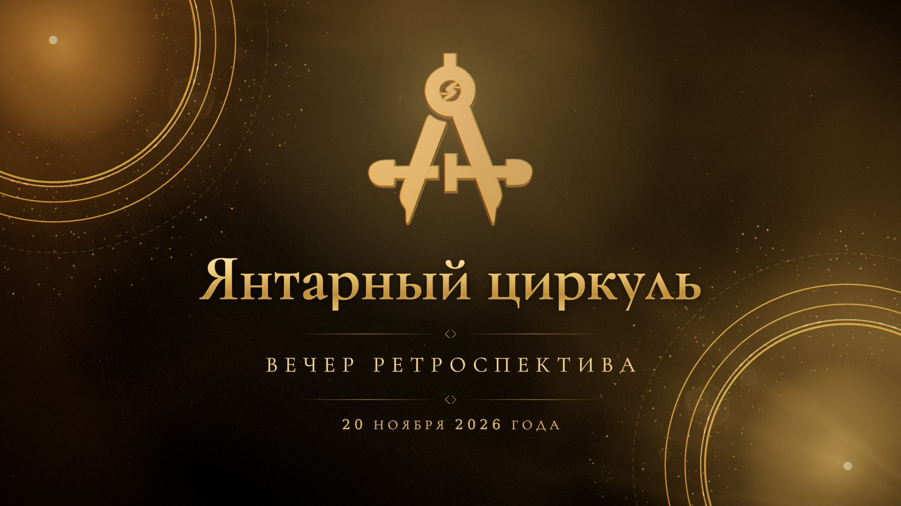

# Янтарный циркуль — режиссёрский аниматик стартового интро

**Формат:** 1920×1080, петля 15,3 с, 60 FPS. Время ниже — секунды с запуска страницы при значениях `DEFAULTS`. Музыкальные отметки — **предложения**, звук в код не встроен: его нужно согласовать с программой вечера, чтобы повторение не утомляло гостей.

| Время | Ключевой кадр / действие | Звук, если нужен |
| --- | --- | --- |
| 0,00–0,15 | Короткий тёмный старт без логотипа и надписи. | Тишина. |
| 0,15–0,80 | Появляется точка циркуля и начинает очерчивать окружность **раньше** символа. Два угловых кольца — левое верхнее и правое нижнее — строятся дугами, других кругов в кадре нет; за будущим знаком постепенно раскрываются золотые лучи. | Очень тихий сухой «щелчок» чертёжного инструмента. |
| 0,80–1,71 | Точка замыкает окружность; золотой свет набирает силу. | Начинается один мягкий восходящий тон. |
| 1,71–3,05 | Световой наконечник переходит к SVG-контуру и запускает его прорисовку; камера начинает подъезжать, построительная окружность гаснет, знак виден под небольшим углом. | Тон достигает пика в момент передачи и затухает. |
| 3,05–5,15 | Радиальный фронт открывает золото; знак разворачивается к зрителю, проявление подчёркнуто лучами, искрами и коротким бликом. Под ним начинают последовательно собираться буквы названия. | Короткое металлическое раскрытие на переходе в золото. |
| 5,15–6,65 | Блик проходит по символу; подзаголовок и дата тоже пишутся по буквам. Световой акцент постепенно уступает место титрам. | Звук затухает до начала удержания. |
| 6,65–11,95 | Полная композиция: читаемые символ, название, подзаголовок и дата; золотой фон, частицы и кольца продолжают двигаться. Фоновых копий контура вокруг знака нет. | Без повторяющегося акцента. |
| 11,95–13,33 | Дата → подзаголовок → название уходят последовательно. Золото остаётся на мгновение дольше слов. | Тихое обратное затухание, без нового «удара». |
| 13,33–14,25 | Золотая поверхность уходит; детали контура растворяются, свет отматывает линию оголовка к первой точке чертежа. | Мягкая конечная точка. |
| 14,25–15,45 | Точка возвращается на построительную окружность и отматывает её; затем кадр темнеет, и первый и последний кадры петли совпадают. | Тишина. |

## Семь визуальных опорных кадров

**1 · Точка и первый штрих, 0,65 с**

**2 · Передача света, 2,41 с**

**3 · Прорисовка символа, 2,94 с**

**4 · Переход к золоту и названию, 4,31 с**

**5 · Световой проход, 5,69 с**

**6 · Собранная композиция, 8,89 с**

**7 · Обратная прорисовка, 13,84 с**

## Два контрольных style frame

1. **Превращение (~4,2 с):** тёмный металл и тёплая светящаяся кромка; детали циркуля должны читаться, белых пятен нет. Построительная окружность исчезает после передачи света знаку; на удержании вокруг него нет фонового контура.
2. **Собранная композиция (~8,8 с):** на лицевой поверхности — мягкий переход от светлого золота слева сверху к глубокому янтарю справа внизу; боковые грани сохраняют отражения, фактура остаётся тонкой. Название первично, угловые огни поддерживают глубину, дата читаема на реальном экране с дистанции зала.

Проверять не только два кадра, но и переходы между ними: в браузере `?review=1` или клавиша **R** открывают шкалу времени с этими семью точками, паузой и шагом по кадрам. Семь ключевых кадров в `docs/storyboard/` — обзорные JPEG, не финальный мастер. Чтобы переснять их после изменения сцен: `npm run dev`, затем `OUT=docs/storyboard npm run render:storyboard`. Скрипт берёт время фаз из текущего конфига и обновляет `timing.json`; без `OUT` кладёт результаты в `out/storyboard/` (не в Git). Для итогового ролика — `npm run render:frames`.

## Границы арт-дирекшена

- Одна причинно-следственная линия: **свет → инструмент → символ → название**, а не независимые спецэффекты.
- Блик проходит по символу только при сборке надписи и затухает до её полного удержания. Угловой свет и движение фона становятся тише, когда текст готов.
- Фактура золота только на металле; тонкая и отфильтрованная на мелких размерах, без муара.
- Петля должна оставаться без заметного стыка и без звукового события в конце/начале.
- Для следующих заставок можно переиспользовать чертёжный жест, меняя текст, паузы и финальный кадр; сценарии следующих сцен согласовываются отдельно.
